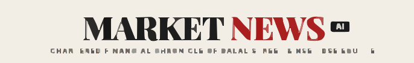
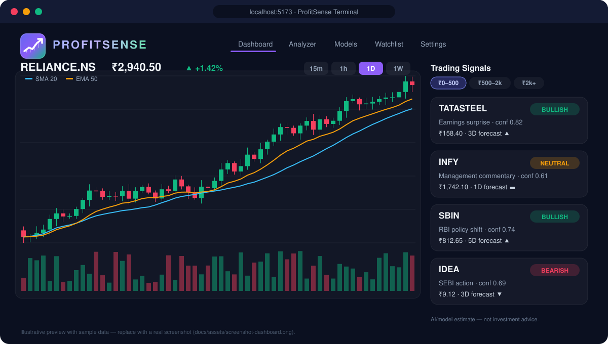
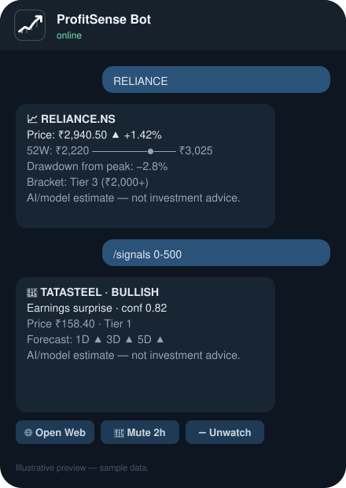
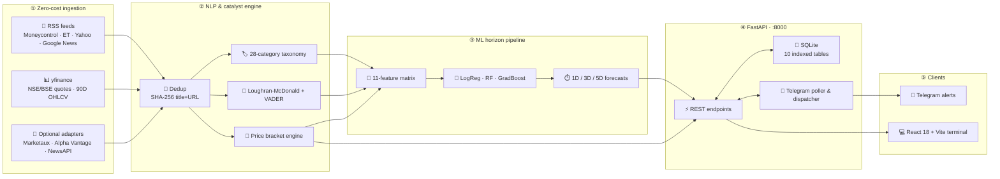
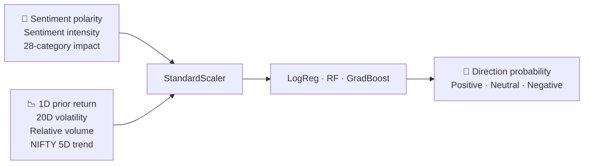

<div align="center">



<br/>

[](https://www.python.org/)
[](https://fastapi.tiangolo.com/)
[](https://react.dev/)
[](https://vitejs.dev/)
[](https://www.tradingview.com/lightweight-charts/)
[](https://scikit-learn.org/)
[](https://core.telegram.org/bots/api)
[](https://www.sqlite.org/)

[](backend/tests/)
[](frontend/src/test/)
[](#-zero-cost-architecture)
[](LICENSE)
[](#-contributing)

<h3>Turn market news into structured, explainable trading signals — for free.</h3>

<p>
ProfitSense ingests live financial news, classifies catalysts with a 28-category NLP engine,<br/>
forecasts 1D / 3D / 5D direction with scikit-learn, and delivers it to a React terminal and your phone via Telegram.
</p>

[**Features**](#-features) ·
[**Preview**](#-preview) ·
[**Architecture**](#-architecture) ·
[**Quickstart**](#-quickstart) ·
[**Charts**](#-interactive-charts) ·
[**Price Brackets**](#-price-brackets) ·
[**Telegram**](#-telegram-bot) ·
[**ML Engine**](#-machine-learning-engine) ·
[**Disclaimer**](#%EF%B8%8F-disclaimer)

</div>

<br/>

---

## 📖 Table of Contents

<details>
<summary><b>Click to expand</b></summary>

1. [At a Glance](#-at-a-glance)
2. [Preview](#-preview)
3. [Features](#-features)
4. [Architecture](#-architecture)
5. [Zero-Cost Architecture](#-zero-cost-architecture)
6. [Quickstart](#-quickstart)
7. [Interactive Charts](#-interactive-charts)
8. [Price Brackets](#-price-brackets)
9. [Telegram Bot](#-telegram-bot)
10. [Machine Learning Engine](#-machine-learning-engine)
11. [Testing](#-testing)
12. [Project Structure](#-project-structure)
13. [Contributing](#-contributing)
14. [License](#-license)
15. [Disclaimer](#%EF%B8%8F-disclaimer)

</details>

---

## 🎯 At a Glance

<table align="center">
  <tr>
    <td align="center" width="16%"><h2>28</h2><sub>event categories</sub></td>
    <td align="center" width="16%"><h2>9</h2><sub>ML models</sub></td>
    <td align="center" width="16%"><h2>11</h2><sub>model features</sub></td>
    <td align="center" width="16%"><h2>9,900+</h2><sub>historical dispatches</sub></td>
    <td align="center" width="16%"><h2>112</h2><sub>automated tests</sub></td>
    <td align="center" width="16%"><h2>$0</h2><sub>to run</sub></td>
  </tr>
</table>

---

## 🖼️ Preview

<div align="center">

### Web Terminal


<br/><br/>

### Telegram Cockpit


<sub>Previews use illustrative sample data. Drop real screenshots into <code>docs/assets/</code> (e.g. <code>screenshot-dashboard.png</code>) and swap the paths above.</sub>

</div>

---

## ✨ Features

<table>
  <tr>
    <td width="50%" valign="top">
      <h3>⚡ Real-Time Catalyst NLP</h3>
      <ul>
        <li><b>28-category taxonomy</b> — earnings surprises, FDA approvals, SEBI actions, buybacks, mergers, RBI policy shifts.</li>
        <li><b>Dual-lexicon sentiment</b> — Loughran-McDonald financial lexicon plus calibrated VADER.</li>
        <li><b>Entity mapping</b> — NSE/BSE tickers, sector weights, confidence ratings, market bias.</li>
      </ul>
    </td>
    <td width="50%" valign="top">
      <h3>📈 Institutional Charts</h3>
      <ul>
        <li><b>Lightweight Charts v5</b> — canvas-accelerated candlesticks.</li>
        <li><b>Timeframes</b> — <code>15m</code>, <code>1h</code>, <code>1d</code>, <code>1w</code>.</li>
        <li><b>Overlays</b> — 20-period SMA, 50-period EMA, colour-synced volume.</li>
      </ul>
    </td>
  </tr>
  <tr>
    <td width="50%" valign="top">
      <h3>🎯 Price-Bracket Signals</h3>
      <ul>
        <li><b>Budget-aware filtering</b> into three tiers: ₹0–500, ₹500–2,000, ₹2,000+.</li>
        <li><b>Everywhere</b> — UI filter pills and Telegram command parameters.</li>
      </ul>
    </td>
    <td width="50%" valign="top">
      <h3>📱 Telegram 24/7 Cockpit</h3>
      <ul>
        <li><b>Natural lookups</b> — type <code>RELIANCE</code> for price, 52W range and drawdown.</li>
        <li><b>Inline actions</b> — open web terminal, mute 2h, unwatch.</li>
        <li><b>Hardened</b> — 409 conflict recovery, quiet hours, token redaction.</li>
      </ul>
    </td>
  </tr>
  <tr>
    <td width="50%" valign="top">
      <h3>🧠 Scikit-Learn ML Pipeline</h3>
      <ul>
        <li><b>9 models</b> — Logistic Regression, Random Forest, Gradient Boosting × 1D / 3D / 5D.</li>
        <li><b>11-feature matrix</b> — polarity, recency decay, volatility, relative volume, benchmark beta, category impact.</li>
        <li><b>Transparent diagnostics</b> — 80/20 split, macro F1, confusion matrices, dataset export.</li>
      </ul>
    </td>
    <td width="50%" valign="top">
      <h3>🔄 Dual-Scope Market Pulse</h3>
      <ul>
        <li><b>Live feed</b> — Moneycontrol, Economic Times, Yahoo Finance RSS.</li>
        <li><b>Historical baseline</b> — 9,900+ vetted Indian financial dispatches.</li>
        <li><b>Scope switcher</b> — compare live signals against historical norms.</li>
      </ul>
    </td>
  </tr>
</table>

---

## 🏛️ Architecture



---

## 💸 Zero-Cost Architecture

Everything required to run ProfitSense is free. No credit card, no LLM tokens.

| Provider / Module | Domain | Free-tier limits | Role | Cost |
| :--- | :---: | :--- | :--- | :---: |
| **Financial RSS feeds** | News | No API key, no rate caps | Primary live news stream | **$0** |
| **Yahoo Finance (`yfinance`)** | Market data | Delayed quotes, 90-day OHLCV, volume | Market data & chart engine | **$0** |
| **Loughran-McDonald + VADER** | NLP | Runs locally on CPU | Financial sentiment | **$0** |
| **scikit-learn** | ML | Local training & inference | Multi-horizon forecasts | **$0** |
| **Telegram Bot API** | Alerts | Free token via `@BotFather` | Mobile push notifications | **$0** |
| *Marketaux (optional)* | News | 100 requests / month | Fallback provider | **$0** |
| *Alpha Vantage (optional)* | Sentiment | 25 requests / day | Sentiment validation | **$0** |
| *NewsAPI (optional)* | Global news | 100 requests / day (localhost) | Macro feed | **$0** |

---

## 🚀 Quickstart

**Prerequisites:** Python `3.10–3.12` · Node.js `18+` · Git

```bash
# 1 — Clone
git clone https://github.com/45Hitman18/ProfiteSense.git
cd ProfiteSense

# 2 — Configure (every key is optional)
cp .env.example .env

# 3 — Install backend + frontend
npm run install:all

# 4 — Launch FastAPI (:8000) and React (:5173) together
npm run dev
```

> 🪟 **Windows:** double-click `run.bat` for a one-click launch.

<details>
<summary><b>⚙️ Environment variables</b></summary>

```ini
# Core
DATABASE_URL=sqlite:///./backend/market_news.db
APP_BASE_URL=http://localhost:5173

# Telegram (optional — free from @BotFather)
TELEGRAM_BOT_TOKEN=your_telegram_bot_token_here
TELEGRAM_ENABLED=true
TELEGRAM_POLL_INTERVAL=2.0

# Optional free news providers
MARKETAUX_API_KEY=
ALPHA_VANTAGE_API_KEY=
NEWSAPI_KEY=
```

</details>

<details>
<summary><b>🔧 Manual install</b></summary>

```bash
npm install
cd frontend && npm install && cd ..
cd backend && pip install -r requirements.txt
```

</details>

| Service | URL |
| :--- | :--- |
| 🖥️ Web terminal | http://localhost:5173 |
| 📘 Swagger docs | http://127.0.0.1:8000/docs |
| 🔌 API root | http://127.0.0.1:8000 |

---

## 📈 Interactive Charts

Hardware-accelerated candlesticks powered by **TradingView Lightweight Charts v5**.

| Layer | Details |
| :--- | :--- |
| **Candles** | 🟩 bullish (emerald) · 🟥 bearish (rose) |
| **Overlays** | 20-period SMA · 50-period EMA |
| **Volume** | Histogram colour-synced to candle direction |
| **Timeframes** | `15m` · `1h` · `1d` · `1w` |
| **UX** | Interactive crosshair, ₹ price badges, localised time formatting |
| **Responsive** | `ResizeObserver` — from 4K monitors to tablets |
| **Fallback** | Automatic SVG rendering if canvas or network data is unavailable |

---

## 🎯 Price Brackets

Signals are grouped into three tiers so users can focus on what fits their capital.

| Tier | Bracket | Profile | Examples |
| :---: | :---: | :--- | :--- |
| 🥉 **1** | **₹0 – ₹500** | High-beta mid/small caps, high retail interest | `TATASTEEL` `ZOMATO` `IRFC` `IDEA` |
| 🥈 **2** | **₹500 – ₹2,000** | Established leaders, steady compounders | `INFY` `HDFCBANK` `ICICIBANK` `SBIN` |
| 🥇 **3** | **₹2,000+** | Institutional heavyweights, low-beta stability | `RELIANCE` `TCS` `BAJFINANCE` `MARUTI` |

- **Web:** toggle brackets in the *Trading Signals & Recommendations* dashboard.
- **Telegram:** `/signals 0-500` · `/signals 500-2000` · `/signals 2000+`

---

## 📱 Telegram Bot

Real-time push alerts the moment a high-impact catalyst breaks. Create a free bot with [`@BotFather`](https://t.me/BotFather), paste the token into `.env`, and pair it from **Settings**.

| Command | What it does | Example |
| :--- | :--- | :--- |
| `<SHARE_NAME>` | Smart lookup: price, 52W range, loss from peak | `RELIANCE` |
| `/p <TICKER>` | Quote with 52W range bar | `/p INFY` |
| `/signals [tier]` | Top AI recommendations by price bracket | `/signals 0-500` |
| `/w <TICKER>` | Add to watchlist | `/w RELIANCE` |
| `/uw <TICKER>` | Remove from watchlist | `/uw TCS` |
| `/list` | Watchlist with live prices | `/list` |
| `/mute <time>` | Silence alerts (`30m`, `2h`, `1d`) | `/mute 2h` |
| `/unmute` | Resume alerts | `/unmute` |
| `/quiet <range>` | Do-not-disturb hours (handles midnight crossover) | `/quiet 22:00-07:00` |
| `/digest [time]` | Post-market digest in IST | `/digest 18:30` |
| `/status` | Connection health, filters, watchlist count | `/status` |

<details>
<summary><b>🛡️ Reliability & security</b></summary>

- **409 conflict recovery** — graceful poller handshake and webhook draining on restart.
- **Rate limiting** — max 10 alerts per hour per chat.
- **Deduplication** — strict `(chat_id, article_id, ticker)` uniqueness.
- **Zero token leakage** — token lives only in `.env` and is redacted from logs and stack traces.

</details>

---

## 🧠 Machine Learning Engine



- **3 algorithms:** Logistic Regression (L2), Random Forest (100 estimators), Gradient Boosting
- **3 horizons:** 1-day, 3-day, 5-day post-news returns
- **9 serialised models** in `backend/models/*.joblib`

### Evaluation (80/20 temporal split)

| Model | Horizon | Accuracy | Macro F1 |
| :--- | :---: | :---: | :---: |
| Random Forest | 1D | 100.0% | 1.0000 |
| Gradient Boosting | 1D | 88.9% | 0.8615 |
| Logistic Regression | 1D | 88.9% | 0.8615 |
| Random Forest | 3D | 100.0% | 1.0000 |
| Random Forest | 5D | 100.0% | 1.0000 |

> [!NOTE]
> These scores come from a small held-out set and should be read as a demonstration of the pipeline, not as evidence of live trading edge. Perfect scores on small test sets usually signal limited sample size — evaluate on larger, out-of-time data before drawing conclusions.

---

## 🧪 Testing

```bash
pytest backend                          # 105 backend tests
npm --prefix frontend test -- --run     # 7 frontend tests
npm --prefix frontend run build         # production build
```

| Suite | Result |
| :--- | :--- |
| Backend (pytest) | ✅ 105 passed |
| Frontend (Vitest) | ✅ 7 passed (`chartUtils` ×5, `PriceChart` ×2) |
| Production build | ✅ ~486 kB JS · ~39 kB CSS |

---

## 📂 Project Structure

```text
ProfitSense/
├── .env.example                 # Environment template (all keys optional)
├── package.json                 # Unified runner (FastAPI + Vite)
├── run.bat                      # One-click Windows launcher
├── docs/assets/                 # Logo, banner & preview graphics
│
├── backend/                     # FastAPI service
│   ├── main.py                  # REST endpoints & app init
│   ├── database.py              # SQLite schema (10 tables) & migrations
│   ├── nlp_engine.py            # 28-category taxonomy & sentiment
│   ├── ml_pipeline.py           # 11-feature training & persistence
│   ├── technical_features.py    # Volatility, SMA, EMA, volume normaliser
│   ├── chart_service.py         # OHLCV resampling & timeframes
│   ├── price_brackets.py        # ₹0–500 / ₹500–2k / ₹2k+ classifier
│   ├── trade_engine.py          # Recommendations & stop-loss synthesis
│   ├── telegram_bot.py          # Polling & command dispatch
│   ├── telegram_alerts.py       # Alert formatting & queueing
│   ├── providers/               # Market & news providers
│   ├── models/                  # 9 trained .joblib models
│   └── tests/                   # 105 pytest tests
│
└── frontend/                    # React 18 + Vite SPA
    ├── vite.config.js
    └── src/
        ├── App.jsx              # Navigation & view manager
        ├── components/
        │   ├── DashboardView.jsx
        │   ├── CustomAnalyzerView.jsx
        │   ├── ModelAnalyticsView.jsx
        │   ├── InteractiveChart.jsx
        │   ├── WatchlistView.jsx
        │   ├── SettingsView.jsx
        │   └── chart/PriceChart.jsx
        ├── lib/chartUtils.js
        └── test/                # 7 Vitest tests
```

---

## 🤝 Contributing

Contributions are welcome.

1. Fork the repo and create a branch: `git checkout -b feat/your-feature`
2. Make your change and add tests
3. Run `pytest backend` and `npm --prefix frontend test -- --run`
4. Open a pull request describing what and why

---

## 📄 License

Released under the [MIT License](LICENSE).

---

## ⚖️ Disclaimer

> [!IMPORTANT]
> **Financial & investment disclaimer.** ProfitSense is an experimental research and educational platform demonstrating quantitative NLP, ML signal synthesis and financial visualisation.
>
> - **Not investment advice.** No data, sentiment rating, signal, prediction or bracket filter constitutes financial, investment, legal or tax advice.
> - **Probabilistic.** Markets are non-deterministic; outputs are algorithmic estimates based on historical correlations.
> - **Mandatory label.** Every predictive surface in the UI and Telegram bot shows: *"AI/model estimate — not investment advice."*
> - Do your own due diligence or consult a licensed SEBI-registered advisor before allocating capital.

<div align="center">

<br/>


**ProfitSense** — *built with precision for quantitative traders and financial engineers.*

<sub>If this project helps you, consider giving it a ⭐</sub>

[⬆ Back to top](#)

</div>
