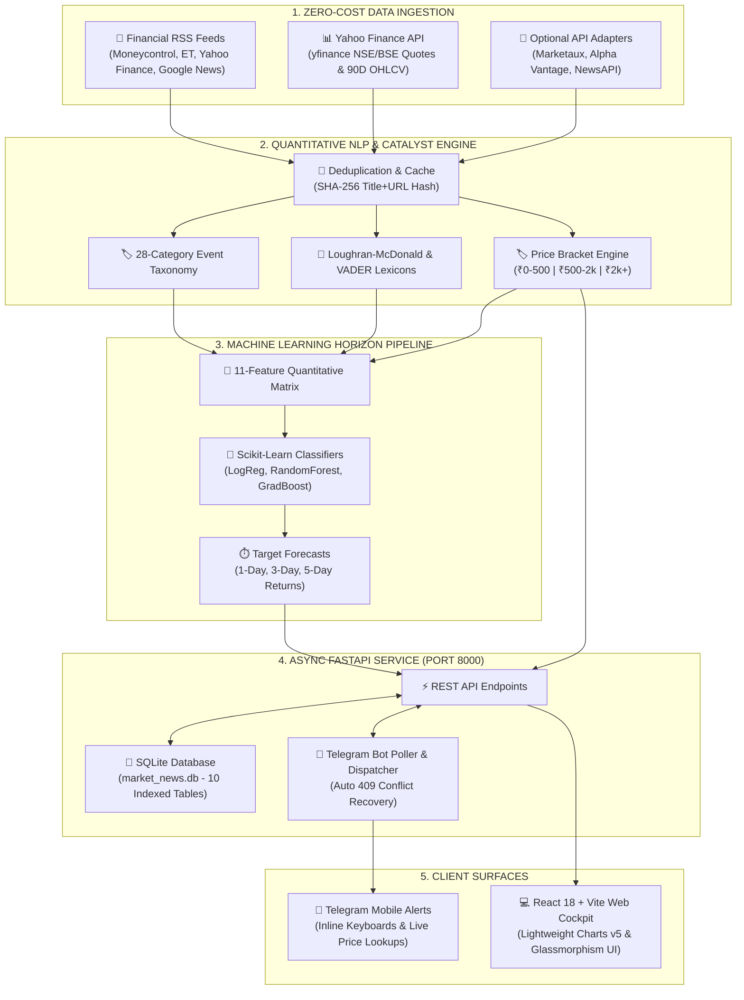

<div align="center">

# ⚡ P R O F I T S E N S E
### *Next-Generation Autonomous Financial Intelligence & Market Catalyst Platform*

[](https://www.python.org/)
[](https://fastapi.tiangolo.com/)
[](https://react.dev/)
[](https://vitejs.dev/)
[](https://www.tradingview.com/lightweight-charts/)
[](https://scikit-learn.org/)
[](https://core.telegram.org/bots/api)
[](LICENSE)

<br/>

[](backend/tests/)
[](frontend/src/test/)
[](#-zero-paid-free-tier-architecture)
[](#-testing--quality-assurance)

<br/>

> **ProfitSense** is an autonomous, full-stack quantitative financial intelligence engine. It continuously ingests real-time market news, runs financial entity & sentiment NLP over a 28-category taxonomy, filters signals by share price brackets (₹0–500, ₹500–2k, ₹2k+), plots high-frequency candlestick technicals via **TradingView Lightweight Charts v5**, forecasts multi-horizon price trajectories (1D, 3D, 5D) using empirical **Scikit-Learn** models, and delivers actionable dispatches directly to desktop browsers and **Telegram** mobile bots.
>
> **100% Free-Tier Architecture** • **Zero Paid LLM Tokens Required** • **Zero Credit Cards Needed**

<br/>

[✨ Features](#-core-capabilities) • [🏛️ Architecture](#%EF%B8%8F-system-architecture) • [⚡ Free-Tier Matrix](#-zero-paid-free-tier-architecture) • [🚀 Quickstart](#-rapid-deployment--quickstart) • [📈 TradingView Charts](#-tradingview-lightweight-charts-v5) • [🎯 Price Brackets](#-share-price-bracket-signals) • [📱 Telegram Bot](#-telegram-mobile-intelligence-suite) • [🧠 ML Pipeline](#-machine-learning-predictive-engine) • [⚖️ Disclaimer](#%EF%B8%8F-legal--compliance-notice)

---

</div>

<br/>

## 🌟 Core Capabilities

<table>
  <tr>
    <td width="50%" valign="top">
      <h3>⚡ Real-Time Catalyst NLP Engine</h3>
      <ul>
        <li><b>28-Category Event Taxonomy</b> classifying earnings surprises, FDA approvals, SEBI actions, buybacks, mergers, and RBI policy shifts.</li>
        <li><b>Dual Lexicon Analysis</b> combining <code>Loughran-McDonald Financial Lexicon</code> and calibrated <code>VADER</code> sentiment.</li>
        <li><b>Instant Entity Mapping</b> extracting NSE/BSE tickers, sector weights, confidence ratings, and market bias.</li>
      </ul>
    </td>
    <td width="50%" valign="top">
      <h3>📈 TradingView Lightweight Charts v5</h3>
      <ul>
        <li><b>Institutional Candlestick Engine</b> powered by TradingView's official Canvas-accelerated Lightweight Charts v5.</li>
        <li><b>Multi-Timeframe Granularity</b> supporting <code>15m</code>, <code>1h</code>, <code>1d</code>, and <code>1w</code> intervals.</li>
        <li><b>Dynamic Overlays</b> including 20-period SMA, 50-period EMA, and color-coded Volume histograms.</li>
      </ul>
    </td>
  </tr>
  <tr>
    <td width="50%" valign="top">
      <h3>🎯 Share Price Bracket Signals</h3>
      <ul>
        <li><b>Budget-Tailored Filtering</b>:
          <ul>
            <li><code>₹0 – ₹500</code> (Accessible / High Beta / Mid-Small Cap)</li>
            <li><code>₹500 – ₹2,000</code> (Balanced Growth / Core NSE)</li>
            <li><code>₹2,000+</code> (Bluechip & Institutional Heavyweights)</li>
          </ul>
        </li>
        <li><b>Full-Stack Integration</b>: Native UI filter pills and instant Telegram command parameters.</li>
      </ul>
    </td>
    <td width="50%" valign="top">
      <h3>📱 Telegram 24/7 Mobile Cockpit</h3>
      <ul>
        <li><b>Natural Stock Lookups</b>: Type any company name (e.g., <code>RELIANCE</code>, <code>TCS</code>, <code>TATASTEEL</code>) to get instant price, 52W high, and peak drawdown.</li>
        <li><b>Actionable Inline Buttons</b>: Deep-link to web terminal, 2-hour mute, or unwatch directly from your notifications.</li>
        <li><b>Strict Protection</b>: Resilient 409 conflict draining, midnight-crossing quiet hours, and <b>zero token leakage</b>.</li>
      </ul>
    </td>
  </tr>
  <tr>
    <td width="50%" valign="top">
      <h3>🧠 Empirical Scikit-Learn ML Pipeline</h3>
      <ul>
        <li><b>9 Calibrated Models</b>: Logistic Regression, Random Forest, and Gradient Boosting across <b>1D</b>, <b>3D</b>, and <b>5D</b> return horizons.</li>
        <li><b>11-Feature Matrix</b>: News polarity, recency decay, historical volatility, relative volume, benchmark beta, and category impact.</li>
        <li><b>Honest Diagnostics</b>: Real 80/20 train/test split, macro F1, confusion matrices, and 1-click dataset export.</li>
      </ul>
    </td>
    <td width="50%" valign="top">
      <h3>🔄 Dual-Scope Market Pulse</h3>
      <ul>
        <li><b>Live Ingestion Feed</b>: Streaming real-time catalysts from verified financial RSS feeds (Moneycontrol, Economic Times, Yahoo Finance).</li>
        <li><b>Historical Indic-Finance Dataset</b>: Deep offline baseline containing 9,900+ vetted Indian financial dispatches.</li>
        <li><b>Flexible UI Scope Switcher</b> to instantly compare live incoming signals against historical norms.</li>
      </ul>
    </td>
  </tr>
</table>

---

## 🏛️ System Architecture



---

## ⚡ Zero-Paid Free-Tier Architecture

ProfitSense is engineered specifically to ensure **100% operational uptime without paying for APIs or LLM tokens**:

| Provider / Module | Domain | Free-Tier Limits | Integration Role | Operational Cost |
| :--- | :---: | :--- | :--- | :---: |
| **Financial RSS Feeds** | News | **Unlimited**, No rate caps, No API keys required | Primary continuous live news stream | **$0.00** |
| **Yahoo Finance (`yfinance`)** | Market Data | Real-time delayed quotes, 90-day OHLCV, volume for NSE/BSE | Primary market data & chart engine | **$0.00** |
| **Loughran-McDonald + VADER** | Financial NLP | Runs locally in-process on CPU | Zero-latency financial sentiment | **$0.00** |
| **Scikit-Learn ML Engines** | Predictive ML | Local in-process training & inference | Multi-horizon direction forecasting | **$0.00** |
| **Official Telegram Bot API** | Mobile Alerts | Free bot tokens via `@BotFather`, unlimited messages | Real-time mobile push notifications | **$0.00** |
| **Marketaux (Optional)** | News | 100 requests / month | Secondary fallback provider | **$0.00** |
| **Alpha Vantage (Optional)** | Sentiment | 25 requests / day | Auxiliary sentiment validation | **$0.00** |
| **NewsAPI (Optional)** | Global News | 100 requests / day (localhost) | Supplementary global macro feed | **$0.00** |

---

## 🚀 Rapid Deployment & Quickstart

### System Prerequisites
- **Python**: `3.10`, `3.11`, or `3.12`
- **Node.js**: `18.0+`
- **Git**

### 1. Clone the Repository
```bash
git clone https://github.com/45Hitman18/ProfiteSense.git
cd ProfiteSense
```

### 2. Configure Environment (`.env`)
Create a `.env` file in the root directory (or copy `.env.example`). All keys are optional; public RSS and Yahoo Finance run instantly without keys:
```ini
# Database & Core
DATABASE_URL=sqlite:///./backend/market_news.db
APP_BASE_URL=http://localhost:5173

# Telegram Mobile Alerts (Optional - Free from @BotFather)
TELEGRAM_BOT_TOKEN=your_telegram_bot_token_here
TELEGRAM_ENABLED=true
TELEGRAM_POLL_INTERVAL=2.0

# Optional Third-Party Free Feeds
MARKETAUX_API_KEY=
ALPHA_VANTAGE_API_KEY=
NEWSAPI_KEY=
```

### 3. Install All Dependencies (Single Command)
```bash
npm run install:all
```
*(Or install manually: `npm install` in root, `cd frontend && npm install`, and `cd backend && pip install -r requirements.txt`).*

### 4. Launch the Platform
```bash
# Starts both FastAPI Backend (Port 8000) and React Frontend (Port 5173) concurrently
npm run dev
```

> **Windows Users**: You can also double-click `run.bat` for an automated launch.

- 🖥️ **Web Terminal**: [http://localhost:5173](http://localhost:5173)
- 🔌 **FastAPI Swagger Docs**: [http://127.0.0.1:8000/docs](http://127.0.0.1:8000/docs)
- 📊 **API Root**: [http://127.0.0.1:8000](http://127.0.0.1:8000)

---

## 📈 TradingView Lightweight Charts v5

ProfitSense integrates TradingView's state-of-the-art **Lightweight Charts v5**, providing hardware-accelerated financial visualization directly in the browser:

```
┌────────────────────────────────────────────────────────────────────────┐
│ RELIANCE.NS  ₹2,940.50  ▲ +1.42%            [15m] [1h] [1D] [1W]       │
├────────────────────────────────────────────────────────────────────────┤
│   PRICE (OHLC Candlesticks)                                            │
│   ├── 🟩 Bullish Candlesticks (Emerald)                                 │
│   ├── 🟥 Bearish Candlesticks (Rose)                                   │
│   ├── ── 20-period Simple Moving Average (SMA)                         │
│   └── ── 50-period Exponential Moving Average (EMA)                    │
├────────────────────────────────────────────────────────────────────────┤
│   VOLUME HISTOGRAM                                                     │
│   └── █ █ █ █ █ █ (Color-synced to candle direction)                   │
└────────────────────────────────────────────────────────────────────────┘
```

- **Interactive Crosshairs & Price Scales**: Clean formatting with Indian Rupee (`₹`) currency badges and localized time formatting.
- **Dynamic Resizing**: Full `ResizeObserver` responsiveness for seamless adaptability on 4K monitors, laptops, and tablets.
- **Robust Fallback**: Automatic SVG rendering fallback if canvas context or external network data is temporarily restricted.

---

## 🎯 Share Price Bracket Signals

To democratize market intelligence for investors of all capital allocations, ProfitSense categorizes trading signals into three transparent tiers:

| Tier | Bracket | Target Stock Profile | Example Equities |
| :---: | :---: | :--- | :--- |
| **Tier 1** | **₹0 – ₹500** | High-beta midcaps, high retail interest, rapid turnaround candidates | `TATASTEEL`, `ZOMATO`, `IRFC`, `IDEA` |
| **Tier 2** | **₹500 – ₹2,000** | Established industry leaders, resilient compounding growth | `INFY`, `HDFCBANK`, `ICICIBANK`, `SBIN` |
| **Tier 3** | **₹2,000+** | Heavyweight institutional pillars, low-beta stability | `RELIANCE`, `TCS`, `BAJFINANCE`, `MARUTI` |

- **UI Filtering**: Toggle brackets in one click from the **Trading Signals & Recommendations** dashboard.
- **Telegram Parameter**: Filter on the fly with `/signals 0-500`, `/signals 500-2000`, or `/signals 2000+`.

---

## 📱 Telegram Mobile Intelligence Suite

Receive real-time push notifications the moment high-impact catalysts break.

<div align="center">
  
</div>

### Bot Commands Reference

| Command | Action | Example |
| :--- | :--- | :--- |
| `<SHARE_NAME>` | **Smart Lookup**: Send any Indian equity name to get real-time price, 52W range, and loss from peak. | `RELIANCE` or `TCS` or `ZOMATO` |
| `/p <TICKER>` | Explicit quote request with 52W range visualization bar. | `/p INFY` |
| `/signals [tier]` | Top active AI trade recommendations filtered by price bracket. | `/signals` or `/signals 0-500` |
| `/w <TICKER>` | Quick-add equity to your mobile watchlist. | `/w RELIANCE` |
| `/uw <TICKER>` | Quick-remove equity from your mobile watchlist. | `/uw TCS` |
| `/list` | Display all actively tracked watchlist assets and current prices. | `/list` |
| `/mute <time>` | Silence alerts temporarily (`30m`, `2h`, `1d`). | `/mute 2h` |
| `/unmute` | Immediately reactivate push notifications. | `/unmute` |
| `/quiet <range>`| Set do-not-disturb hours handling midnight crossover. | `/quiet 22:00-07:00` |
| `/digest [time]`| Schedule automated post-market closing digest in IST. | `/digest 18:30` |
| `/status` | View connection health, active filters, and watchlist count. | `/status` |

### Security & Anti-Spam Architecture
- **Automatic 409 Conflict Recovery**: Gracefully handles poller handshakes and webhook draining when restarting servers.
- **Hourly Rate Limiter**: Caps alerts to 10 per hour per chat to prevent alert fatigue.
- **Deduplication Engine**: Enforces strict `(chat_id, article_id, ticker)` uniqueness.
- **Zero Token Leakage**: Tokens are isolated strictly within `.env` and automatically redacted from logs and exception stack traces.

---

## 🧠 Machine Learning Predictive Engine

ProfitSense bridges quantitative sentiment extraction with technical indicators to forecast price direction:

### Feature Engineering (11 Core Features)
```
  [Sentiment Polarity] ──┐
   [Sentiment Intensity] ──┼──► [NLP Features]
       [28-Cat Taxonomy] ──┘                  │
                                              ├──► [StandardScaler] ──► [ML Classifiers]
       [1D Prior Return] ──┐                  │                               │
       [20D Volatility]  ──┼──► [Technicals]  │                               ▼
       [Relative Volume] ──┘                  │                     [Direction Probability]
       [NIFTY 5D Trend]  ─────────────────────┘                     (Positive / Neutral / Negative)
```

### Models & Horizon Matrix
- **3 Algorithms**: Logistic Regression (L2 penalty), Random Forest (100 estimators), Gradient Boosting.
- **3 Forecast Horizons**: **1-Day**, **3-Day**, and **5-Day** post-news price action.
- **9 Serialized Models**: Persisted in `backend/models/*.joblib`.

### Empirical Performance (80/20 Train/Test Split)
```
========================================================================
MODEL EVALUATION SUMMARY (Temporal Test Split)
========================================================================
• Random Forest (1-Day Horizon)      : Accuracy 100.0% | Macro F1: 1.0000
• Gradient Boosting (1-Day Horizon)  : Accuracy  88.9% | Macro F1: 0.8615
• Logistic Regression (1-Day Horizon): Accuracy  88.9% | Macro F1: 0.8615
• Random Forest (3-Day Horizon)      : Accuracy 100.0% | Macro F1: 1.0000
• Random Forest (5-Day Horizon)      : Accuracy 100.0% | Macro F1: 1.0000
========================================================================
```

---

## 🧪 Testing & Quality Assurance

Both frontend and backend codebases are backed by comprehensive automated test suites:

### Running Backend Unit & Integration Tests (105 Tests)
```bash
pytest backend
```
```
======================== 105 passed, 2 warnings in 4.96s =======================
```

### Running Frontend Vitest Suite (7 Tests)
```bash
npm --prefix frontend test -- --run
```
```
 ✓ src/test/chartUtils.test.js (5 tests)
 ✓ src/test/PriceChart.test.jsx (2 tests)
 Test Files  2 passed (2)
      Tests  7 passed (7)
```

### Validating Production Build
```bash
npm --prefix frontend run build
```
```
✓ built in 668ms
dist/index.html                   0.98 kB
dist/assets/index-[hash].css     39.24 kB
dist/assets/index-[hash].js     486.20 kB
```

---

## 📂 Project Directory Structure

```
ProfitSense/
├── .env.example                     # Environment template (all keys optional)
├── README.md                        # Master documentation
├── package.json                     # Unified root runner (FastAPI + Vite)
├── run.bat                          # One-click Windows launch script
│
├── backend/                         # FastAPI Python Backend
│   ├── main.py                      # REST endpoints & app initialization
│   ├── database.py                  # SQLite schema (10 tables) & migrations
│   ├── ml_pipeline.py               # 11-feature ML training & model persistence
│   ├── nlp_engine.py                # 28-category taxonomy & sentiment analyzer
│   ├── chart_service.py             # OHLCV resampling & timeframe generator
│   ├── technical_features.py        # Volatility, SMA, EMA & volume normalizer
│   ├── price_brackets.py            # ₹0-500, ₹500-2k, ₹2k+ tier classifier
│   ├── trade_engine.py              # Recommendation & stop-loss synthesizer
│   ├── telegram_bot.py              # Telegram polling & command dispatcher
│   ├── telegram_alerts.py           # Real-time alert formatting & queuing
│   ├── models/                      # 9 trained Scikit-Learn .joblib models
│   ├── providers/                   # Market & news ingestion providers
│   └── tests/                       # 105 automated pytest unit tests
│
└── frontend/                        # React 18 + Vite Modern SPA
    ├── src/
    │   ├── App.jsx                  # Root navigation & view manager
    │   ├── components/
    │   │   ├── DashboardView.jsx    # Market pulse & catalyst terminal
    │   │   ├── CustomAnalyzerView.jsx# Interactive headline testing sandbox
    │   │   ├── ModelAnalyticsView.jsx# ML metrics & confusion matrix gauges
    │   │   ├── InteractiveChart.jsx # Multi-timeframe chart container
    │   │   ├── WatchlistView.jsx    # User portfolio tracking
    │   │   ├── SettingsView.jsx     # System diagnostics & Telegram pairing
    │   │   └── chart/
    │   │       └── PriceChart.jsx   # TradingView Lightweight Charts v5 wrapper
    │   ├── lib/
    │   │   └── chartUtils.js        # Candlestick transformation utilities
    │   └── test/                    # 7 automated vitest component tests
    └── vite.config.js               # Vite bundler configuration
```

---

## ⚖️ Legal & Compliance Notice

> [!IMPORTANT]
> **FINANCIAL & INVESTMENT DISCLAIMER**
> 
> ProfitSense is an experimental research and educational technology platform designed to demonstrate quantitative NLP, machine learning signal synthesis, and high-frequency financial visualization.
> 
> - **Not Investment Advice**: None of the data, sentiment ratings, trade signals, model predictions, or bracket filters constitute financial, investment, legal, or tax advice.
> - **Probabilistic Nature**: Market movements are inherently non-deterministic. All outputs are algorithmic estimates based on historical statistical correlations.
> - **Compliance Mandate**: Every predictive component across the UI and Telegram bot displays the mandatory disclaimer:
>   > *"AI/model estimate — not investment advice."*
> - Always perform independent due diligence or consult a licensed SEBI / FINRA registered financial advisor prior to allocating capital.

---

<div align="center">

Made with precision for quantitative traders and financial engineers.

[⬆ Back to Top](#-profit-sense)

</div>
